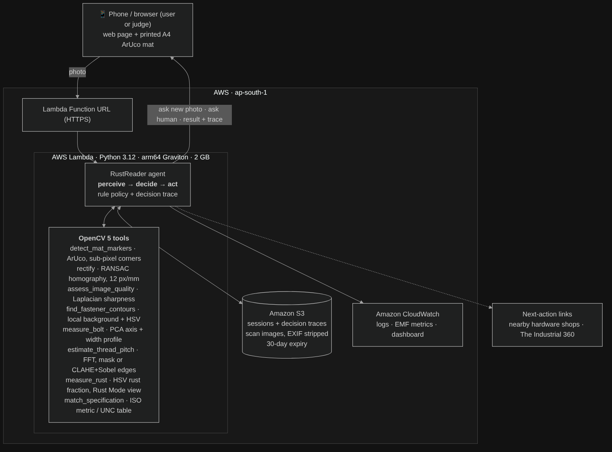

# RustReader Deep Scan — OpenCV 5 agent on AWS

Identifies **old, rusted bolts** by thread size, pitch and length from one phone photo,
judges rust severity, and tells the user what to do next (replace? where to buy?).
Built for the OpenCV AI Competition 2026 (Agentic Vision path).

> Rusted fasteners hide their markings. A mechanic who can't read a ₹30 bolt ends up
> guessing ("closest fit") or travelling to shops with the old part. RustReader measures it.

**Live endpoint:** https://5t2v7gt4kwkghxncjnzdd6g5zi0kldaf.lambda-url.ap-southeast-2.on.aws/
**Code:** https://github.com/mylaimani/rustreader-deep-scan
**Demo video:** _(paste link)_

## How it works (one paragraph)
The user places the bolt on a printed A4 mat with four ArUco markers and takes a photo.
An agent runs OpenCV 5 tools in a **perception → decision → action loop**: markers give scale
and perspective, the photo is straightened to 12 px/mm, the bolt is segmented and measured from
its width profile, thread pitch is found with an FFT of the thread edge, rust is measured in HSV,
and the result is matched against ISO metric / UNC tables. **What the tools see decides what
happens next**: missing markers, blur or two bolts → ask for a new photo; heavy rust → use the
CLAHE + Sobel edge tool for pitch; pitch unreadable → ask for a closer photo, then let a human
choose between the top candidates; heavy rust → recommend replacement and link to nearby shops.
Every step is recorded in a decision trace that the web page shows.


Agent workflow: [docs/agent_workflow.png](docs/agent_workflow.png)

## Folder layout
| Path | What it is |
|---|---|
| `vision/` | OpenCV 5 tools (markers, rectification, quality, segmentation, measurement, thread pitch, rust, spec matching) |
| `agent/rustreader_agent.py` | The perception → decision → action loop and decision trace |
| `api/lambda_handler.py` | AWS Lambda handler (Function URL) — web page, `/analyze`, `/answer`, `/session/<id>` |
| `api/local_server.py` | Runs the same handler on a laptop (no AWS needed) |
| `web/index.html` | Judge/user web page (camera upload, result, rust views, trace) |
| `infra/` | `deploy.sh`, `smoke_test.sh`, `teardown.sh`, CloudWatch dashboard |
| `eval/` | Ground-truth CSVs and `evaluate.py` |
| `tools/` | Printable mat generator, synthetic photo generator, CLI runner |
| `docs/` | Mat PDF, diagrams, technical report |

## 1. Run locally (Mac / Linux, Python 3.10+)
```bash
cd rustreader_cloud
python3 -m venv .venv && source .venv/bin/activate
pip install -r requirements.txt          # pinned: opencv-python-headless==5.0.0.93, numpy==2.2.6
python api/local_server.py                # open http://localhost:8080
```
Command line, with the decision trace:
```bash
python tools/run_local.py samples/synthetic/M12x1.25x50_heavy.jpg --trace
python tools/run_local.py samples/synthetic/fail_threads_worn_M10.jpg samples/synthetic/fail_threads_worn_M10.jpg --answer M10x1.25 --trace
```

## 2. Deploy to AWS (about 5 minutes)
Requirements: an AWS account. Easiest: open **AWS CloudShell** in the console (top bar `>_` icon),
upload this folder as a zip (Actions → Upload file), then:
```bash
unzip rustreader_cloud.zip && cd rustreader_cloud
AWS_REGION=ap-southeast-2 bash infra/deploy.sh   # deployed region: Sydney
bash infra/smoke_test.sh <FunctionURL printed by deploy.sh>
```
`deploy.sh` is idempotent (re-run it to update the code). It creates:
- **S3** bucket `rustreader-scans-<account>-<region>`: private, public access blocked, scans and sessions expire after 30 days
- **IAM role**: CloudWatch Logs + read/write on that bucket only
- **Lambda** `rustreader-deep-scan`: Python 3.12, **arm64 (Graviton)**, 2048 MB, 30 s, OpenCV 5 wheels bundled
- **Function URL** (public HTTPS; invoke permission restricted to the URL)
- **CloudWatch**: 14-day log retention and a `RustReader` dashboard (agent outcomes, latency p50/p95, errors)

Remove everything afterwards with `bash infra/teardown.sh`.

## 3. Evaluate
```bash
python eval/evaluate.py eval/synthetic_ground_truth.csv   # synthetic bolts with exact truth
python eval/evaluate.py eval/ground_truth.csv             # real photos + caliper measurements
```
Writes `*_results.csv` (per photo) and `*_results_summary.txt`.

## 4. Printing the mat
`docs/RustReader_Measuring_Mat_A4.pdf` — print at **100% / Actual size**, check the 100 mm ruler.
Regenerate with `python tools/make_marker_sheet.py`.

## Responsible use
Advisory only: a photo cannot detect stretch, fatigue, cracks or thread damage. Heavy rust always
leads to "replace", torque-to-yield bolts are flagged single-use, and the system asks a human
whenever two sizes fit almost equally. Uploaded images are re-encoded (EXIF/GPS removed), stored
privately and deleted after 30 days.
